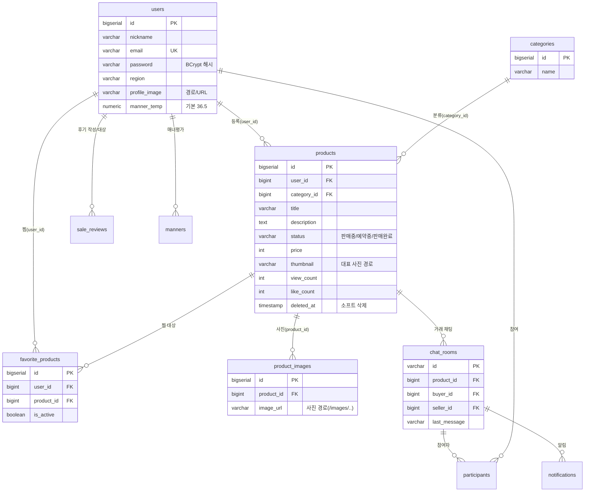

# 🗂 ERD — 중고거래 플랫폼 (jsp-web-project)

> 기준: `schema.sql` (PostgreSQL 16). 핵심 도메인은 users · products · product_images.

## 관계 다이어그램 (Mermaid)

## 핵심 관계 요약

| 관계 | 설명 | 삭제 정책 |
|---|---|---|
| users → products | 한 사용자가 매물 여러 개 등록 | 사용자 삭제 시 매물 CASCADE |
| categories → products | 매물은 카테고리 1개(선택) | 카테고리 삭제 시 SET NULL |
| **products → product_images** | **매물 1개에 사진 여러 장** (다중 이미지) | 매물 삭제 시 CASCADE |
| users ↔ products (favorite) | 찜 (user, product) UNIQUE | 양쪽 CASCADE |
| products → chat_rooms | 매물별 거래 채팅 | 매물 삭제 시 SET NULL |

## 구현에서 실제 사용하는 테이블

현재 애플리케이션이 읽고 쓰는 테이블:
- **users** — 가입/로그인/프로필 (UserDAO)
- **products** — 매물 CRUD, 대표 사진(thumbnail), 소프트 삭제, 조회수 (ProductDAO)
- **product_images** — 매물 다중 사진 (ProductDAO.insertImages / findImageUrls)
- **categories** — 시드 7개 (등록 폼에서 미사용, 추후 분류 기능 여지)

> favorite_products·chat_rooms·participants·notifications·manners·sale_reviews는 스키마에만 존재(찜/채팅/알림/후기 미구현). 확장 여지로 남김.
